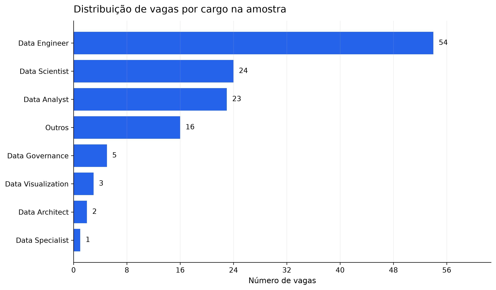
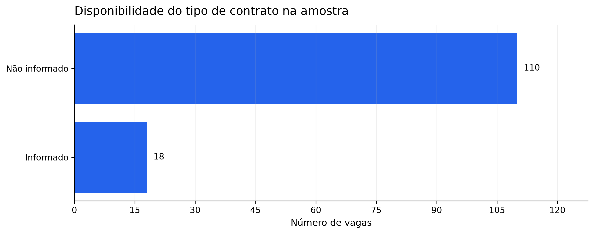

# Data AI Job Market Intelligence

Projeto de portfólio em Python que coleta, limpa, classifica e analisa uma amostra de vagas de Dados e Inteligência Artificial no Brasil a partir da API da Adzuna.

O objetivo desta primeira versão é demonstrar um pipeline completo e reproduzível — da requisição à API até um dataset analítico e visualizações — com atenção à qualidade dos dados, à segurança das credenciais e aos limites da fonte.

> **Importante:** os resultados descrevem somente a amostra coletada pelo termo `data`. Eles não representam todo o mercado de trabalho brasileiro.

## Visão geral do pipeline

```text
API da Adzuna
    ↓
Resposta JSON
    ↓
DataFrame e extração de campos aninhados
    ↓
Limpeza, filtro temporal e sanitização de URLs
    ↓
Classificação de cargos e localizações
    ↓
Remoção de registros fora do escopo analítico
    ↓
Dataset processado e análise exploratória
    ↓
Gráficos salvos em reports/figures/
```

## Fonte dos dados

- **Fonte:** API da Adzuna.
- **País consultado:** Brasil (`br`).
- **Termo de busca:** `data`.
- **Coleta da v1:** 3 páginas, com até 50 resultados por página.
- **Filtro temporal:** anúncios publicados em 2026.

As credenciais são lidas de um arquivo `.env` local e não são versionadas. As query strings das URLs retornadas pela API são removidas antes que o dataset seja salvo, evitando persistir identificadores de acesso.

## Metodologia

1. Validação inicial da estrutura com um piloto manual de três vagas.
2. Autenticação com variáveis de ambiente.
3. Teste de conexão e inspeção segura dos campos da API.
4. Coleta paginada de vagas.
5. Extração de empresa, localização e categoria de objetos aninhados.
6. Conversão de datas e filtro do ano de análise.
7. Sanitização das URLs de redirecionamento.
8. Classificação baseada em regras para cargos e localizações.
9. Exclusão de falsos positivos apenas do dataset analítico.
10. Análise exploratória de cargos, empresas, geografia, contratos e valores ausentes.

## Principais resultados exploratórios

Na execução de 25 de outubro de 2026:

- 150 vagas foram coletadas;
- 136 permaneceram após o filtro de anúncios publicados em 2026;
- 128 compõem o dataset analítico após a remoção de registros classificados como fora do escopo;
- `Data Engineer` foi a categoria mais frequente **na amostra**, com 54 vagas;
- 110 de 128 registros (85,9%) não informavam `contract_type`;
- 79 de 128 registros (61,7%) tinham localização genérica em nível de Brasil;
- 117 de 128 registros (91,4%) não informavam salário mínimo ou máximo;
- a mediana do tamanho das descrições foi de 500 caracteres, evidenciando o truncamento da fonte.





## Estrutura do projeto

```text
Data AI Job Market Intelligence/
├── data/
│   ├── raw/
│   │   └── jobs_pilot.csv
│   └── processed/
│       └── jobs_analysis.csv
├── notebooks/
│   └── 01_data_collection.ipynb
├── reports/
│   └── figures/
│       ├── disponibilidade_contrato.png
│       ├── distribuicao_cargos.png
│       ├── distribuicao_localizacoes.png
│       └── principais_empresas.png
├── .env.example
├── .gitignore
├── README.md
└── requirements.txt
```

## Tecnologias utilizadas

- Python
- Jupyter Notebook
- pandas
- requests
- python-dotenv
- Matplotlib

## Como executar

### 1. Criar e ativar um ambiente virtual

No PowerShell:

```powershell
python -m venv .venv
.\.venv\Scripts\Activate.ps1
```

### 2. Instalar as dependências

```powershell
pip install -r requirements.txt
```

### 3. Configurar as credenciais

Copie `.env.example` para `.env` e preencha as credenciais obtidas na Adzuna:

```dotenv
ADZUNA_APP_ID=seu_app_id
ADZUNA_APP_KEY=sua_app_key
```

O arquivo `.env` está listado no `.gitignore` e nunca deve ser enviado ao GitHub.

### 4. Executar o notebook

Abra `notebooks/01_data_collection.ipynb` no VS Code ou Jupyter e execute todas as células em ordem. Como alternativa:

```powershell
python -m jupyter nbconvert --execute --to notebook --inplace notebooks/01_data_collection.ipynb
```

## Limitações

- A busca por `data` não cobre todas as vagas de Dados/IA e também recupera falsos positivos.
- Os resultados dependem do momento da coleta e dos critérios de indexação da Adzuna.
- As descrições retornadas têm aproximadamente 500 caracteres; portanto, uma análise de skills seria incompleta nesta versão.
- Campos de contrato e salário apresentam alta ausência.
- Muitas localizações são fornecidas apenas como `Brasil`.
- A classificação de cargos e localizações usa regras textuais e não substitui revisão humana.
- Os resultados não devem ser generalizados para todo o mercado brasileiro.

## Próximos passos

Possíveis evoluções, deixadas deliberadamente fora do escopo da v1:

- ampliar e comparar fontes de dados;
- evoluir a classificação de cargos com NLP;
- analisar skills com descrições mais completas;
- automatizar coletas periódicas;
- criar uma aplicação interativa em Streamlit.

## Segurança

- `.env` e `.venv/` são ignorados pelo Git;
- credenciais não são exibidas em células ou outputs;
- URLs retornadas pela API são sanitizadas antes do salvamento;
- o notebook evita mostrar a resposta JSON completa, pois ela pode conter identificadores em URLs de redirecionamento.
